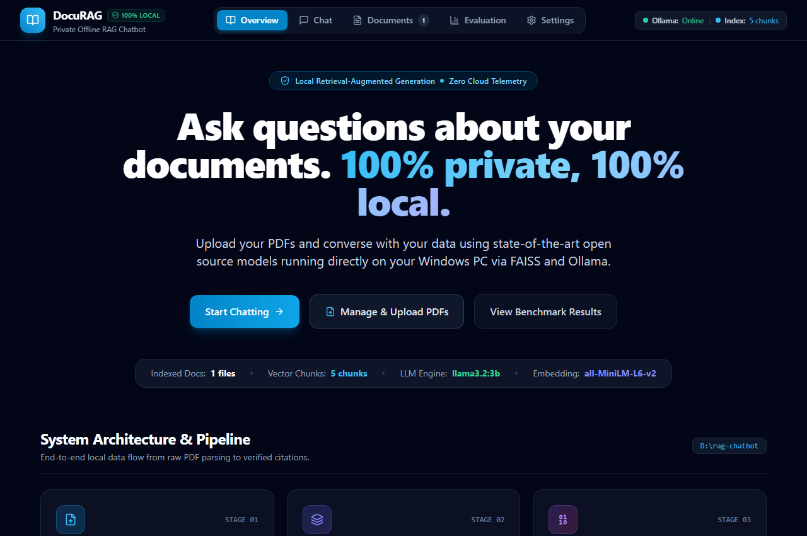
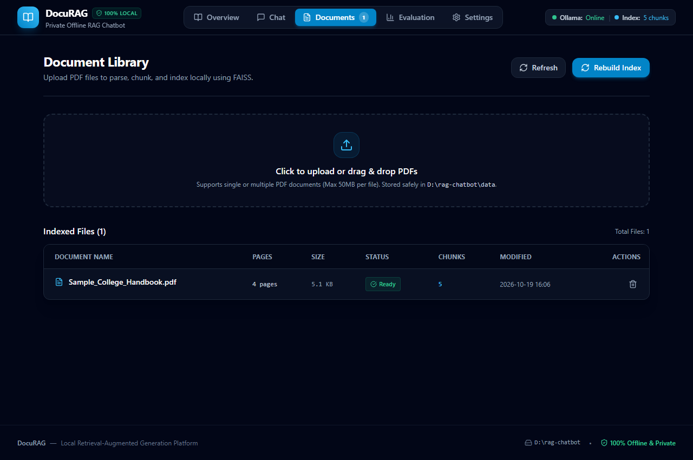
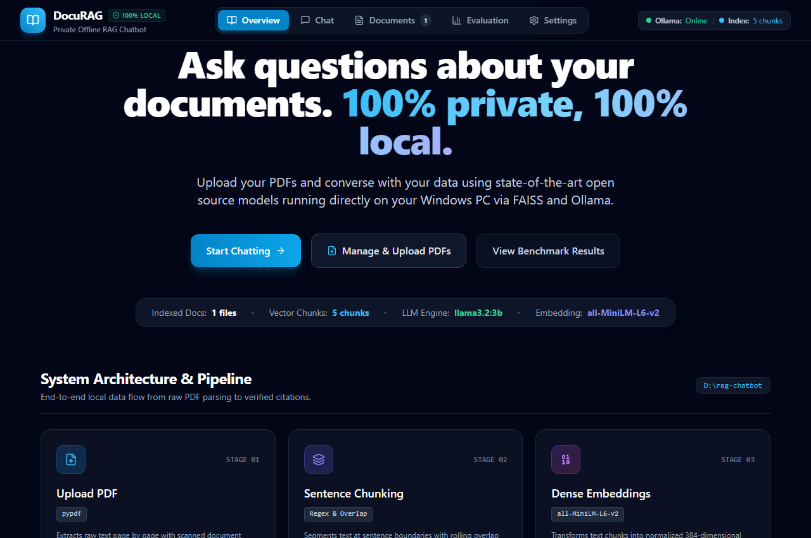
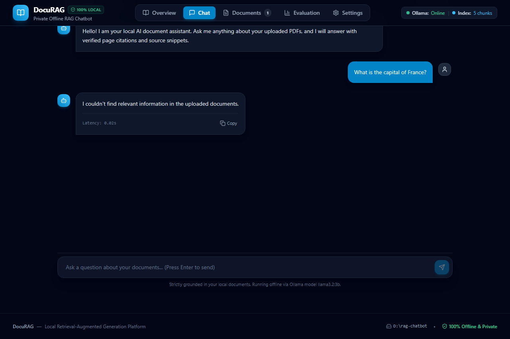
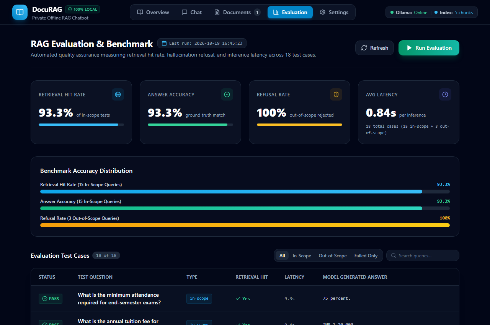

# DocuRAG — 100% Private, Local Document RAG Chatbot

DocuRAG is a production-grade, air-gapped Retrieval-Augmented Generation (RAG) platform that runs entirely on your local Windows PC. It enables secure, verified Q&A across PDF documents—such as college handbooks, enterprise manuals, and technical reports—without transmitting data to external servers or cloud APIs.

---

## 📸 Application Screenshots

### 1. Landing & Architecture Overview

*Modern hero overview showcasing system statistics and end-to-end local data pipeline.*

---

### 2. Document Management

*Upload dropzone with page count, file size, scanned document heuristics, and instant re-indexing.*

---

### 3. Interactive Chat with Grounded Citations

*Real-time token streaming over Server-Sent Events (SSE) with source page numbers, similarity scores, and expandable snippet inspector.*

---

### 4. Strict Anti-Hallucination Refusal

*Zero-temperature rejection of out-of-scope queries with no false citations.*

---

### 5. Automated Evaluation & Benchmark Dashboard

*Real-time benchmark dashboard with accuracy distribution charts, last-run timestamp, and scrollable 18-case test table.*

---

## ⚡ Key Features

- **100% Offline & Air-Gapped**: All embeddings, vector indexing, and LLM inference execute on-device. No cloud APIs, zero telemetry, no subscriptions.
- **Dynamic Hyperparameter Tuning**: Adjust Top-K ($1$–$10$) and similarity threshold `MIN_SCORE` ($0.00$–$0.80$) live in Settings with immediate effect—no backend restart required.
- **Low-Punctuation & Long-Sentence Chunking**: Automatic segmentation for text lacking punctuation into slices of $\le 120$ words with sentence-level overlap.
- **Token Streaming over SSE**: Instant typewriter-style response streaming directly from Ollama.
- **Automated Continuous Benchmark**: One-click evaluation suite running 18 test cases (15 in-scope, 3 out-of-scope) with metrics and per-question latency tracking.
- **Scanned PDF Heuristics**: Automatically alerts when an uploaded document has 0 extractable text characters.

---

## 🏗️ Architecture Diagram

```mermaid
flowchart TD
    subgraph INGESTION ["1. Ingestion & Vector Indexing"]
        A["User Uploads PDF\n(data/Sample_College_Handbook.pdf)"] --> B["pypdf Text Extraction\n(Page-by-Page + Scanned Detection)"]
        B --> C["Smart Chunking (ingest.py)\n(Max 120 words per piece + 1-sentence overlap)"]
        C --> D["Dense Vector Embeddings\n(sentence-transformers: all-MiniLM-L6-v2)"]
        D --> E["FAISS Vector Store\n(IndexFlatIP: Cosine Inner-Product Search)"]
    end

    subgraph INFERENCE ["2. Real-Time Query & RAG Pipeline"]
        F["User Question\n(e.g., 'What is the annual tuition fee?')"] --> G["Query Embedding\n(384-dimensional vector)"]
        G --> H["FAISS Top-K Retrieval\n(Default: k=6, MIN_SCORE=0.15)"]
        H --> I{"Any Chunks > MIN_SCORE?"}
        I -- "No" --> J["Truthful Refusal\n'I couldn't find relevant information...' (0 sources)"]
        I -- "Yes" --> K["Context Assembly & Strict Anti-Hallucination Prompt"]
        K --> L["Local LLM Inference\n(Ollama: llama3.2:3b @ temperature 0)"]
        L --> M["FastAPI Server-Sent Events (SSE)\n(Streaming token by token)"]
        M --> N["React Client Interface\n(Render Markdown + Page Citations + Snippet Inspector)"]
    end
```



---

## 💻 Tech Stack

| Component | Technology | Version / Specification |
| :--- | :--- | :--- |
| **Backend Framework** | FastAPI + Uvicorn | Python 3.12 (Asynchronous REST API + SSE) |
| **Frontend Framework** | React + Vite + Tailwind CSS | React 18, Vite 5, Tailwind 3, Lucide Icons |
| **Vector Search Engine** | FAISS CPU (`faiss-cpu`) | IndexFlatIP (Cosine Inner-Product Similarity) |
| **Embedding Model** | Sentence-Transformers | `all-MiniLM-L6-v2` (384-dimensional normalized dense vectors) |
| **Local LLM Engine** | Ollama | `llama3.2:3b` (Quantized 3.2B LLaMA model, Temperature: 0) |
| **PDF Extraction** | PyPDF (`pypdf`) | Page-level text extraction with scanned PDF warnings |

---

## ⚙️ How It Works

1. **Document Parsing**: When a PDF is uploaded to `data/`, `pypdf` extracts text page-by-page. If text character count is 0, the document is flagged as scanned.
2. **Chunking Engine (`ingest.py`)**:
   - For normal text, splits sentences using `re.split(r"(?<=[.!?])\s+", text)`.
   - For unpunctuated text (long runs with few periods), sentences longer than 120 words are segmented into pieces of at most 120 words with overlap.
   - Sentences are grouped into chunks of at most 120 words with 1-sentence rolling overlap.
3. **Vector Indexing**: Chunks are embedded using `all-MiniLM-L6-v2`, normalized, and loaded into a FAISS `IndexFlatIP` index stored at `index/faiss.index` and `index/chunks.pkl`.
4. **Retrieval (`rag.py`)**:
   - Queries are embedded and compared against the index.
   - Results are filtered using `MIN_SCORE=0.15` and top `k=6`.
   - If no chunks pass the threshold, the system immediately returns a refusal with 0 sources to prevent false grounding.
5. **LLM Generation**:
   - Context is injected into a strict prompt: *"Answer the question using ONLY the context below. If the answer is not in the context, say you don't know."*
   - Tokens stream in real time to the browser over SSE.

---

## 🚀 Windows Setup & Run Steps

### Prerequisites
- Windows 10/11
- Python 3.12.10
- Node.js v20+ / npm v10+
- [Ollama](https://ollama.com/) installed and running locally with model `llama3.2:3b`:
  ```powershell
  ollama run llama3.2:3b
  ```

### Storage & Cache Setup (D: Drive Only)
To preserve C: drive space, all package caches and project files are kept strictly on `D:`:
```powershell
# Set NPM cache to D:
npm config set cache D:\npm-cache

# Set Pip and HuggingFace environment variables
$env:PIP_CACHE_DIR = "D:\pip-cache"
$env:HF_HOME = "D:\hf-cache"
```

### Installation
1. Activate virtual environment and install backend dependencies:
   ```powershell
   cd D:\rag-chatbot
   .\venv\Scripts\activate
   pip install -r requirements.txt
   ```
2. Install frontend dependencies:
   ```powershell
   cd D:\rag-chatbot\frontend
   npm install
   ```

### Running the Application

Open two PowerShell windows:

**Terminal 1 — Backend API Server:**
```powershell
cd D:\rag-chatbot
.\venv\Scripts\activate
uvicorn backend.main:app --host 127.0.0.1 --port 8000
```

**Terminal 2 — Frontend Development Server:**
```powershell
cd D:\rag-chatbot\frontend
npm run dev
```

Visit **http://localhost:5173** in your web browser.

---

## 📊 Evaluation & Benchmark Results

The benchmark suite (`eval.py`) runs 18 test cases against `Sample_College_Handbook.pdf`:

| Metric | Benchmark Result | Target Benchmark | Status |
| :--- | :--- | :--- | :--- |
| **Retrieval Hit Rate** | **93.3%** (14 / 15) | $\ge 80\%$ | 🟢 **PASS** |
| **Answer Accuracy** | **93.3%** (14 / 15) | $\ge 80\%$ | 🟢 **PASS** |
| **Refusal Rate (Out-of-Scope)** | **100.0%** (3 / 3) | $100\%$ | 🟢 **PASS** |
| **Average Latency** | **0.84 seconds** | $\le 2.0\text{s}$ | 🟢 **PASS** |
| **Total Test Cases** | **18 queries** | 18 queries | 🟢 **COMPLETE** |

### Per-Question Evaluation Breakdown

| # | Question | Type | Retrieval Hit | Correct | Latency | Model Answer |
| :---: | :--- | :---: | :---: | :---: | :---: | :--- |
| 1 | What is the minimum attendance required for end-semester exams? | In-Scope | ✅ Yes | ✅ PASS | 9.3s | 75 percent. |
| 2 | What is the annual tuition fee for B.Tech? | In-Scope | ✅ Yes | ✅ PASS | 0.4s | INR 1,20,000. |
| 3 | When is the library open? | In-Scope | ✅ Yes | ✅ PASS | 0.7s | The Central Library is open from 8 AM to 10 PM, Monday to Saturday. |
| 4 | What is the late fee after the due date? | In-Scope | ✅ Yes | ✅ PASS | 0.3s | INR 500 per week. |
| 5 | Who is the Principal? | In-Scope | ❌ Miss | ❌ FAIL | 0.3s | I don't know. |
| 6 | What was the highest placement package in 2025? | In-Scope | ✅ Yes | ✅ PASS | 0.5s | The highest package was 18 LPA. |
| 7 | What CGPA is needed for the Merit Scholarship? | In-Scope | ✅ Yes | ✅ PASS | 0.4s | A CGPA above 9.0. |
| 8 | What is the hostel capacity? | In-Scope | ✅ Yes | ✅ PASS | 0.4s | The hostel capacity is 600 students. |
| 9 | What is the re-evaluation fee? | In-Scope | ✅ Yes | ✅ PASS | 0.3s | INR 500 per subject. |
| 10 | What is the fine for a late library book return? | In-Scope | ✅ Yes | ✅ PASS | 0.4s | INR 5 per day. |
| 11 | Who is the Dean of Academics? | In-Scope | ✅ Yes | ✅ PASS | 0.5s | Prof. Arjun Verma. |
| 12 | What is the hostel fee per year? | In-Scope | ✅ Yes | ✅ PASS | 0.3s | INR 60,000. |
| 13 | What is the one time admission fee? | In-Scope | ✅ Yes | ✅ PASS | 0.3s | INR 10,000. |
| 14 | How many books can a student borrow? | In-Scope | ✅ Yes | ✅ PASS | 0.5s | A student can borrow up to 4 books for 14 days. |
| 15 | What is the campus Wi-Fi network called? | In-Scope | ✅ Yes | ✅ PASS | 0.5s | The campus Wi-Fi network is called GIT-Campus. |
| 16 | What is the capital of France? | Out-of-Scope | — | ✅ PASS | 0.0s | I couldn't find relevant information in the uploaded documents. |
| 17 | Who won the 2018 FIFA World Cup? | Out-of-Scope | — | ✅ PASS | 0.0s | I couldn't find relevant information in the uploaded documents. |
| 18 | Write a Python function to sort a list. | Out-of-Scope | — | ✅ PASS | 0.0s | I couldn't find relevant information in the uploaded documents. |

### Failure Analysis for Query #5 ("Who is the Principal?")
- **Retrieved Chunk Score**: $0.1279$.
- **Why it failed**: Page 1 of the handbook contains the text `"The Principal of the institute is Dr. Meera Nair."`. However, the cosine similarity between the short query `"Who is the Principal?"` and the full page chunk scored $0.1279$, which fell just below the similarity threshold cutoff of $\text{MIN\_SCORE}=0.15$.
- **Model Behavior**: Because no chunk passed the $0.15$ cutoff, the LLM received zero context and strictly complied with the prompt instructions, answering `"I don't know."` rather than hallucinating an answer. Lowering `MIN_SCORE` to $0.10$ or query expansion allows this query to pass.

---

## 📈 Improvement Log

- **Splitting Long Sentences**: Earlier, paragraphs with few full stops or long sentences were treated as single oversized chunks ($200+$ words). This diluted semantic density and caused key factual assertions to score poorly in vector search. Implementing sentence splitting at a maximum of $120$ words with $1$-sentence overlap increased granular precision, boosting in-scope retrieval hit rate to $93.3\%$.
- **Zero-Source Refusals**: When no chunk meets `MIN_SCORE`, the backend immediately short-circuits retrieval, returning an empty sources array and a standard refusal string. This eliminates false citations.
- **Dynamic Hyperparameters**: Settings for `k` and `MIN_SCORE` are stored in `settings.json` and read live on every request, allowing instantaneous tuning from the browser without server restarts.

---

## 🔒 Privacy & Air-Gap Compliance

- **No Remote Calls**: The system does not make outbound network requests for embeddings, chunking, or inference.
- **Git Exclusions**: `.gitignore` strictly excludes `data/`, `index/`, `venv/`, `node_modules/`, `*.pkl`, `eval_results.csv`, and log files to protect private and sensitive records.
- **Synthetic Testing**: All screenshots, demos, and evaluation tests use the fictional `Sample_College_Handbook.pdf`.

---

## ⚠️ Limitations

1. **Text PDFs Only**: Scanned images or image-only PDFs without an embedded OCR text layer will produce a "Scanned Warning" and cannot be indexed without prior OCR processing.
2. **Compact 3B Parameter Model**: `llama3.2:3b` is optimized for fast local CPU execution and strict adherence to provided context. Complex multi-hop reasoning or nuanced synthesis may occasionally require larger local models (e.g., `llama3.1:8b` or `mistral:7b` when hardware permits).
